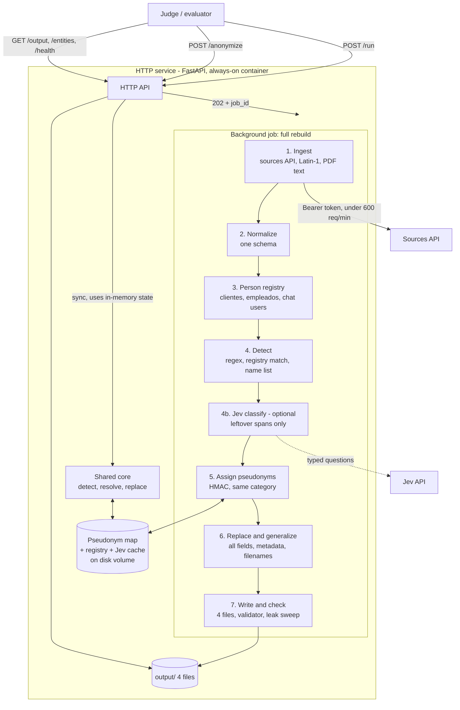

# Architecture — Kipu Pay corpus anonymization service

## 1. Overview

Principle: **deterministic code at request time**. Pi (coding agent) is used to build the pipeline; no agent runs inside requests. Stages 4–6 are one shared core used by both `/run` (batch) and `/anonymize` (live), so a person gets the same pseudonym in both.

## 2. Request flow

| Endpoint | Behaviour | Latency |
|---|---|---|
| `GET /health` | `{status:"ok", team, version, models:["rules", "jev-latest" if enabled]}` | ms |
| `POST /run {sources_url, token}` | Returns `202 {job_id}` immediately; background worker runs stages 1–7 from scratch; one job at a time (repeat calls return the running job — idempotent) | job: minutes (limit 2 h) |
| `GET /run/{job_id}` | `queued / running / done / failed`, `started_at`, `finished_at`, record counts, `cost {tokens_in, tokens_out, seconds}`, `error` | ms |
| `GET /output/{file}` | Serves the 4 files of the last **completed** run (404 if none). Files are written to a temp dir and swapped atomically, so a half-written run is never served | ms |
| `POST /anonymize {source, records}` | Up to 50 records; runs the shared core with the in-memory registry + map; returns same ids anonymized + entities involved; new entities are added to the map | < 5 s target (limit 60 s) |
| `GET /entities` | Full dictionary of the last completed run | ms |

Auth: every call carries `Authorization: Bearer <token>`. The service **accepts and ignores** it for authorization — never rejects the judge.

Cold start: if `/anonymize` arrives before any `/run` (entrypoint validation does this), the core runs with regex + name list + any map saved on disk.

## 3. Components

### 3.1 Ingest
- Lists channels → dates → messages; docs index → files; tables; `record_index`.
- Decodes `clientes.csv` as Latin-1 with `;`, others UTF-8. XML parsed keeping attributes **and comments**.
- PDFs: text via `pdftotext`/`pypdf`, metadata via `pypdf` (Author, Title, Subject, Keywords).
- HTML: body converted to markdown, keeping comments; `<meta>` tags into `metadata`.
- Throttled under 600 req/min, retries with backoff, ETag caching.

### 3.2 Normalize
Builds records in the output schema:
- chats: `id = client_msg_id`, `thread_id = <canal>:<ts of first message>`, `author` = display name from users (never uid), `attachments = [{filename}]`, `<@UID>` resolved to names before detection.
- docs: `id, format, filename, title, body, metadata` with **the same metadata keys** as input.
- tables: `id = <tabla>:<llave>`, all columns as strings.

### 3.3 Person registry
- One entity per `cliente_id` and per `KP-id`; chat users linked by email/name; Slack employees linked to `empleados.xml` by email.
- Each entity stores every form: full name, first name, first + first surname, ALL CAPS, accentless, filename slug, cédula with/without dots, phone with/without +57 and spaces, email, address, birth date, plate/passport if found, Slack handle/display name.
- Gender from the name list (first name) for same-gender pseudonyms.
- Namesakes stay separate because the key is the ID, not the name.

### 3.4 Detect
1. **Regex** for structured identifiers: cédula (6–10 digits, dotted or not), +57 mobiles, emails, spelled emails ("arroba/punto"), plates (`ABC123`), passports (`AR\d{6}`), addresses (Calle/Cra/Diagonal/Tv … #), dates of birth when they match a registry value.
2. **Registry matching** on normalized text (NFKC, casefold, accents stripped, confusables mapped — same normalization as the judge), longest form first.
3. **Name list** (Colombian first names + common surnames) for unknown third parties → create new entities.
4. **Keep-list** of organizations, banks, merchants, places, public figures; a keep-list term is skipped unless it sits inside a matched person name (handles "Santander").

### 3.5 Jev classify (optional, stretch)
- Input: leftover capitalized spans not resolved by 3.4, with their sentence.
- Typed question: `type ∈ {person, organization, place, other}` with probability.
- High-confidence person → new entity; org/place → keep-list; low confidence → mask if name-like, log for review.
- Answers cached by (span, context hash) in the map → deterministic across runs and in `/anonymize`. Hard timeout; on failure skip.

### 3.6 Assign pseudonyms
- `seed = HMAC_SHA256(secret_salt, stable_key)` where stable key = `cliente_id` / `KP-id` / uid / normalized name for unlinked third parties.
- From the seed: same-gender first name(s) + surnames, email in the original pattern and provider (`mcastano@gmail.com` → `szambrano@gmail.com`; employees `nombre.apellido@kipupay.co`), cédula with same length and leading digits but far from original, valid +57 mobile, plausible address and birth date.
- Uniqueness check; on collision, re-draw with a counter. Lookup in the persisted map first, so existing people never change.

### 3.7 Replace and generalize
- Span replacement in every string field: text, body, title, metadata values, filenames, attachment names, XML attributes/comments. Variant-aware (first name → pseudonym first name; CAPS → CAPS; slug → slug; dotted cédula → dotted).
- Quasi-identifiers: occupation → sector table ("periodista" → "profesional de medios"), neighborhood → another neighborhood of the same city, year in identifying context → "hace unos años"; applied to the `clientes` row and to texts mentioning that person.
- `reporta_a` mapped to the short form of the referenced employee's pseudonym.

### 3.8 Write and check
- Writes the 4 files + `entities.json` (originals, pseudonyms, records; kept orgs/places with `kept: true` and `reason`).
- Runs `validar.mjs` and the leak sweep (search every original form across all output with the judge's normalization). Failures are logged in the job result.

### 3.9 State (pseudonym map)
- JSON/SQLite on a persistent volume: entity → pseudonyms, registry snapshot, Jev cache, salt reference (salt itself in an env secret).
- Loaded on boot; updated after each run and by `/anonymize`.

## 4. Deployment

| Item | Choice |
|---|---|
| Runtime | Python 3.11, FastAPI + uvicorn, one container |
| Host | Always-on instance (Railway / Render / Fly) with a persistent volume — no sleeping free tier; must be up from 19:00 to demo day end |
| Secrets | `SALT`, `JEV_API_KEY` (optional) as env vars; sources token arrives in `/run` body, never stored in the repo |
| Repo | pipeline code, `run.sh` (starts the service), `DECISIONS.md`, tests, local scorer |
| Concurrency | `/run` in a background thread/process; `/anonymize` served concurrently from in-memory state behind a lock for map writes |

## 5. Trade-offs

| Choice | Gain | Cost |
|---|---|---|
| Rules core | deterministic, fast, 0 tokens, explainable | lower recall on unknown/rare names (gap L1) |
| Structured registry first | strong namesake and cross-source consistency | relies on tables covering most people; unlinked chat-only people are weaker |
| HMAC + persisted map | stable across growth and restarts | needs a volume and a secret; losing the salt **and** map would change pseudonyms |
| Jev on leftovers only | recall gain at low cost, typed answers | external dependency, early-access model; disabled by default until measured |
| Single process, in-memory | simple, fast for ~8.3k records | doesn't scale to millions of records without a DB-backed map and workers (gap L9) |
| Text extraction for PDFs/HTML | simple, matches output contract | layout and tables in PDFs flattened; minor similarity loss |

## 6. What this architecture does not handle (honest limits)

- **Scale:** in-memory registry and a single worker are sized for this corpus (~435k tokens). Millions of records would need a database, sharded workers and streaming I/O.
- **Unknown-name recall:** without a trained NER (banned libraries, no time), rare/foreign names outside the name list can leak; Jev mitigates only if enabled and accurate.
- **Free-text coreference:** pronouns and indirect references ("su hermana", "la señora del caso anterior") are not resolved to people.
- **OCR / images:** not processed.
- **High availability:** one instance; if the host goes down mid-run, the run is lost. Mitigated by testing the full flow before validating.
- **Concurrency of multiple `/run` calls:** serialized, not parallel.
